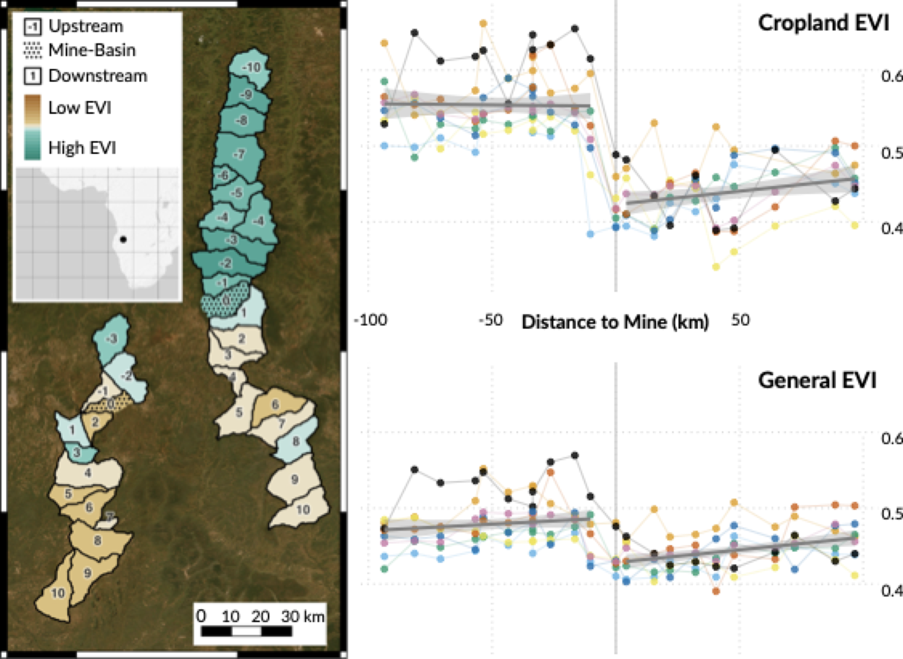

# Hi!

I’m a second-year **PhD student** in the Department of Economics at the **University of Zurich**. My research examines the environmental and social consequences of mining. I use spatial data, especially satellite imagery, and applied microeconomic research designs to study questions in low and middle-income countries. Recently, I have been expanding into **experimental economics** and designing experiments to shed light on topics in political economy. More broadly, I’m interested in **environmental economics**, **behavioural economics**, and **political economy**, and I’m eager to learn about new fields and methods.

Feel free to reach out at [gustav.pirich@econ.uzh.ch](mailto:gustav.pirich@econ.uzh.ch).

# Research

**Downstream Impacts of Mines on Agriculture in Africa**
with Lukas Vashold, Maximilian Heinze, & Nikolas Kuschnig
***Journal of Development Economics***, *179*, 103671. [https://doi.org/10.1016/j.jdeveco.2025.103671](https://doi.org/10.1016/j.jdeveco.2025.103671)
[Click here for the VoxDev article](https://voxdev.org/topic/agriculture/downstream-impacts-mines-how-pollution-hits-agriculture)

+ Abstract & Figure

 

Mining operations in Africa are expanding rapidly, creating negative externalities that remain poorly understood. In this paper, we provide causal evidence for the impact of water pollution from mines on downstream vegetation and agriculture across the continent. We exploit a natural experiment, where mines cause a discontinuity in water pollution along river networks, to compare vegetation health in upstream and downstream locations. We find that mines significantly reduce peak vegetation downstream by 1.3–1.5%, impairing the productivity of over 74,000 km² of croplands. These reductions correspond to annual losses of 91,000–205,000 tons of cereal crops in the immediate vicinity alone, with particularly severe effects in fertile regions and areas where gold mining predominates. Our findings highlight substantial externalities of mining and demonstrate an urgent need for oversight and regulation.

 

Example of two Angolan mine sites (dotted, and labeled with '0') and their upstream and downstream basin systems (left), as well as measurements of the Enhanced Vegetation Index (EVI) for croplands and general vegetation over the years 2016, 2017, 2018, 2019, 2020, 2021, 2022, and 2023 along the larger basin system (right).

---

# Work in Progress

**Gold Mining and Schooling in Ghana**

**Podcast Persuasion**

---

---
